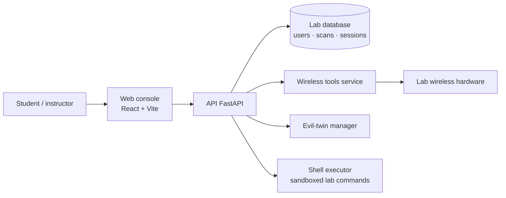

# 📡 PocketGone by Jeturing — WiFi Security Testing Lab for Education

[](https://jeturing.com)
[](https://jeturing.com)
[](https://jeturing.com)

**A web-based laboratory platform for teaching WiFi and wireless security testing in controlled environments: a React console over a FastAPI backend that drives real wireless auditing tools on the lab machine, with session logging and an access-code gate. Built for authorized educational use only.**

> ⚠️ **Authorized use only** — this platform runs real penetration-testing capabilities. It exists for cybersecurity classes and authorized assessments in isolated lab environments. Never point it at networks you do not own or have explicit written permission to test.

> 📍 **Status discipline** — every capability in this README carries its status: **Built** (in `main`, with tests or evidence) · **In development** (on a branch) · **Designed** (specified, not built) · **Concept** (recorded idea). Statuses are never mixed.

| At a glance | |
|---|---|
| **Form** | Web console (React + Vite) + API (FastAPI) for a lab host |
| **State** | Relational database on the backend (sessions, scans, users); tool output streamed over WebSockets |
| **Interfaces** | English |
| **Deployment** | Lab host with wireless auditing tools installed; installer and verification scripts included |

---

## 📋 Table of contents

- [🌐 Position in the ecosystem](#️-position-in-the-ecosystem)
- [🧩 Capabilities and status](#️-capabilities-and-status)
- [🏗️ Architecture](#️-architecture)
- [🗂️ Repository map](#️-repository-map)
- [🔄 Main flows](#-main-flows)
- [🔒 Security model](#-security-model)
- [🖥️ Surfaces and API](#️-surfaces-and-api)
- [🚀 Installation and deployment](#-installation-and-deployment)
- [⚙️ Configuration](#️-configuration)
- [🩺 Troubleshooting](#-troubleshooting)
- [🗺️ Honest limits and roadmap](#️-honest-limits-and-roadmap)
- [📝 Changelog](#-changelog)
- [👥 Credits](#-credits)

## 🌐 Position in the ecosystem

PocketGone belongs to **SEGRD**, Jeturing's protection division: it is the hands-on laboratory where wireless security is taught and practiced before it is applied in real assessments. Its audience is instructors and students in controlled cybersecurity classes, and SEGRD operators rehearsing authorized engagements.

What it is **not**: it is not a product for end customers, it is not a monitoring service, and it must never be exposed on a public network as-is (see the security model).

## 🧩 Capabilities and status

### Wireless laboratory

- **WiFi scanning and analysis** — Built. Network discovery views (`WifiView`) fed by the backend's wireless tools service.
- **Penetration-testing sessions** — Built. Guided attack workflows (`PentestView`) executed by the backend against lab targets, with session records.
- **Airgeddon integration** — Built. Dedicated view and backend support for the airgeddon tooling; implementation notes in [`AIRGEDDON_IMPLEMENTATION.md`](AIRGEDDON_IMPLEMENTATION.md).
- **Evil-twin exercises** — Built. Backend manager and view for access-point impersonation exercises inside the lab.
- **Bluetooth scanning** — Built. Device discovery view (`BluetoothView`) with vendor and signal data.
- **RF spectrum display** — Built. Spectrum visualization (`SpectrumDisplay`) from scan data.
- **Terminal and logs** — Built. In-console terminal view and a logs view over recorded sessions and signals.
- **KPI dashboard** — Built. Overview of lab activity (`KpiDashboard`).

### Platform

- **Access-code login** — Built. The console gates entry with an access code; roles are carried on the user record.
- **Tool auto-installer** — Built. Backend component that checks and installs the lab's tooling (this repository is the newer of the two lab copies and carries it; see the note in the repository map).

## 🏗️ Architecture



The frontend is a single-page console (`App.tsx` + `components/`) that talks to the backend (`backend/main.py`) over REST and WebSockets. The backend owns everything dangerous: tool execution goes through its shell executor and tool services, never from the browser.

## 🗂️ Repository map

```text
PocketGone-By-Jeturing-v1.0/
├── components/             # Console views: WiFi, Bluetooth, Pentest, Airgeddon, Evil Twin, Terminal, Logs, KPI
├── services/               # Frontend services: auth, RF data, AI assistant client
├── backend/                # FastAPI backend: tools, evil twin, shell executor, auto-installer, database
├── docs/                   # Full documentation — index in docs/README.md
├── App.tsx                 # Console root
├── index.html              # Entry page
├── install.sh              # Lab installation script
├── verify-installation.sh  # Installation verification
├── validate-functionality.sh  # Functionality validation run
└── package.json            # Scripts and dependencies
```

The full documentation lives in [`docs/`](docs/README.md), indexed by topic.

> **Two copies of this lab exist in the organization** — this repository (`PocketGone-By-Jeturing-v1.0`, last merged January 2026, with the auto-installer and validation artifacts) and `jeturing/rfid-security-suite` (an earlier copy of the same codebase). They are documented separately and neither is a fork of an external project.

## 🔄 Main flows

### Run a lab exercise

1. The operator starts the backend on the lab host and opens the console.
2. The student signs in with the lab access code.
3. The student picks an exercise (scan, pentest session, evil twin) and the backend runs the real tools against the lab targets.
4. Results stream back to the console and are recorded as sessions and signal logs.

## 🔒 Security model

### Identity

Access-code login at the console; the backend issues the session and the frontend auth service carries it. This is a lab gate, not an enterprise identity system: a deployment outside a classroom must sit behind the house identity (Sajet ID) and a private network.

### Permissions

Roles on the user record separate students from operators; tool execution is always server-side.

### Fail-closed values

- No access code, no console: every exercise requires an authenticated session.
- The platform is designed to run on an isolated lab host; exposing it publicly without an additional identity and network layer is out of scope and unsafe.

## 🖥️ Surfaces and API

| Surface | What it exposes |
|---|---|
| Web console | WiFi, Bluetooth, pentest, airgeddon, evil-twin, spectrum, terminal, logs and KPI views |
| Backend API (`backend/main.py`) | Auth, spectrum data, Bluetooth and WiFi scans, pentest sessions and attack results, WebSocket streaming |

## 🚀 Installation and deployment

### Requirements

- A lab host (Linux) with wireless hardware and the auditing tools the backend drives.
- Node.js for the console; Python 3 with `backend/requirements.txt` for the API.

### Install and run

```bash
./install.sh                    # lab installation
./verify-installation.sh        # verify the installation
npm install && npm run dev      # console
cd backend && pip install -r requirements.txt   # API dependencies (see backend/README.md)
```

### Tests and verification

```bash
./validate-functionality.sh     # functionality validation (results recorded in docs/VALIDATION_RESULTS.md)
npm run build                   # console build
```

## ⚙️ Configuration

| Parameter | Where it lives | Notes |
|---|---|---|
| Backend environment | `backend/.env.example` | Copy to `.env` on the lab host; no values in the repository (the tracked root `.env` is an empty placeholder) |
| Lab access code and users | Backend database | Seeded and managed on the lab host, never in the repo |
| AI assistant key | Frontend service configuration | Optional; the console works without it for the core exercises |

## 🩺 Troubleshooting

### A tool view reports the tool as missing

Run `./verify-installation.sh` on the lab host: it checks each external tool the backend drives. The auto-installer (`backend/auto_installer.py`) can repair a lab installation.

### Scans return nothing

Confirm the wireless interface is up and in the mode the exercise needs, and that the backend — not only the console — is running on the lab host.

## 🗺️ Honest limits and roadmap

### Limits declared

- **Legacy lab**: last activity in this repository is January 2026; it is kept as the reference copy of the lab, not as a continuously deployed service.
- The access-code gate is classroom-grade, not production identity (see the security model).
- Despite the repository name carrying a version suffix, the platform presents itself as v2.0 in its own UI and API metadata.

## 📝 Changelog

### 2026-11-17 — House README standard

- README rewritten to the house skeleton with status discipline, and `docs/` created with a master index that links every guide (the guides stay at the root because the lab scripts check for them there). No code changes.

### 2026-01-05 — Functionality validation merge (`618889b`)

- Merge of the validation branch: all-functionality validation of the lab, with its results recorded.

## 👥 Credits

**Jeturing Inc.** — SEGRD division.
